# Masteriva

**Rehearse the hard conversation out loud, before it's real.** Masteriva is a voice practice platform: you talk to a
realistic AI persona, then get an instant scorecard with the exact moments to redo.

**Live:** [masteriva.com](https://masteriva.com) (private beta)

---

## The problem

People get better at hard conversations by having them, but the real ones are expensive to get wrong: a lost
deal, a bad interview, a damaged relationship with a team member. Role-play with a colleague is awkward and rare,
and written courses don't build the reflex of saying the right thing under pressure.

## What it does

- **Voice practice for real situations.** Warm and cold sales calls, screeners, closing meetings and voicemail;
  recruiter screens, behavioral, technical and system-design interviews and offer negotiation; leadership
  conversations; a startup pitch; front-desk calls. **32 starter personas** (19 role-play characters and 13 short
  drills) across **5 tracks**, plus "Create a scenario" from a job description or situation.
- **Instant scorecards.** A score out of 100, talk share, filler words and objections handled, the two moments to
  redo with a stronger line for each, and one thing to focus on today. Every scorecard ends with one next step and
  a **Run it again** button.
- **Repetition to mastery.** **46 named skills**. Each call counts as a rep for the skills it trains. Difficulty
  (Easy, Realistic, Tough) moves per skill with your scores, and a skill is mastered only after repeated strong reps
  across several days, including at Tough. **Today** prescribes the next reps for your weakest skills, and endless
  daily **programs** add a 2-minute note, tips to say out loud and a real-world challenge.
- **Team training.** Owners assign training (scenarios, skills, programs, documents) with due dates. Progress comes
  from activity only, never a checkbox. **People and progress** shows reps, averages, weakest skills and a skills
  heatmap, with alerts and a weekly team report.
- **Hiring assessments.** A role link invites candidates to the same standard test calls. Candidates consent to AI
  scoring first and choose whether to share each report. Reports are computed from the rubric, a person makes every
  decision, and passing at Tough on two different days earns a **certificate** with a public verification page.
- **Real calls next to practice.** Log real calls by hand (outcome, notes, optionally a pasted transcript to score) and compare practice scores with real outcomes;
  when real calls trail practice, that skill gets priority.

## Screenshots

All screenshots come from a local instance seeded with sample data (a fictional team, sample names).

| Today | Live call | Scorecard |
| --- | --- | --- |
| 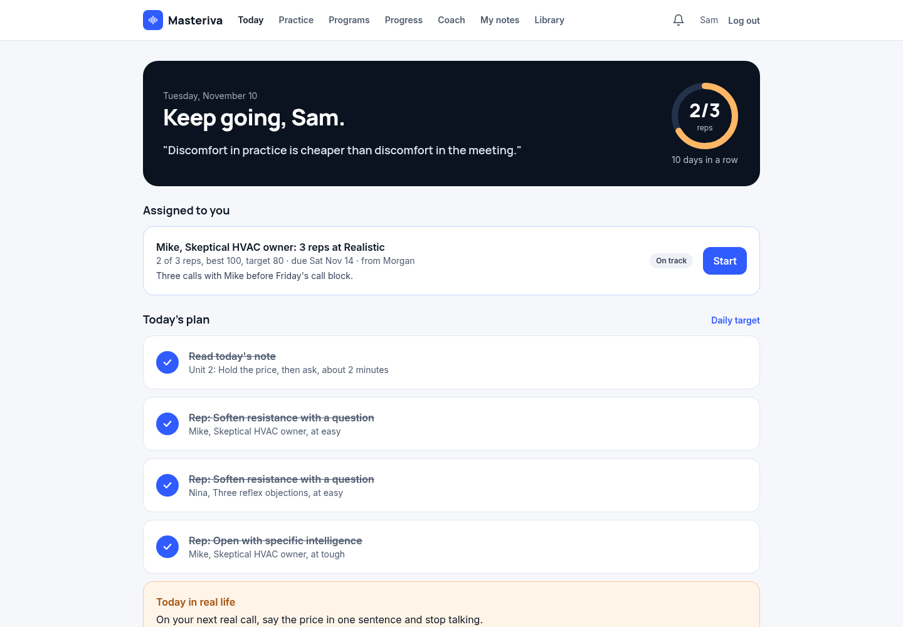 | 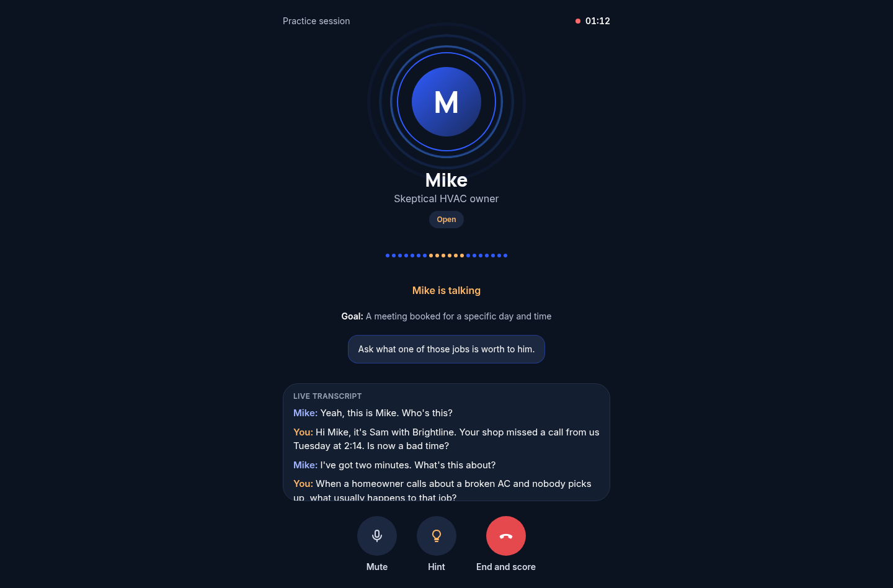 | 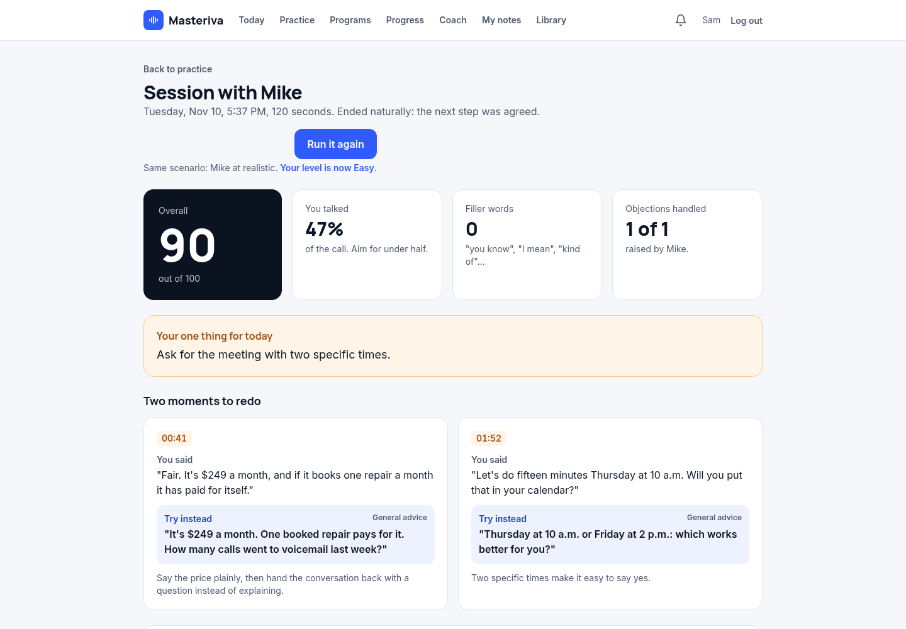 |
| **Progress** | **Team** | **People and progress** |
| 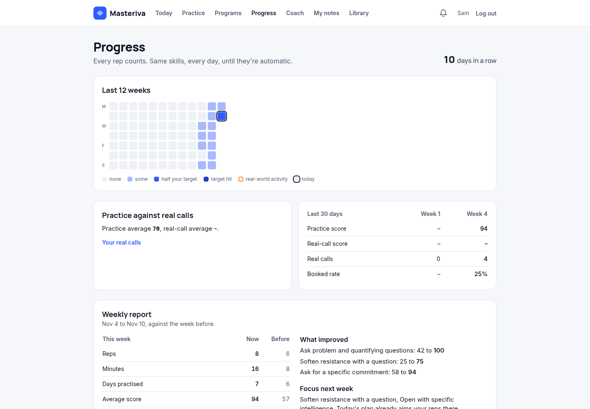 | 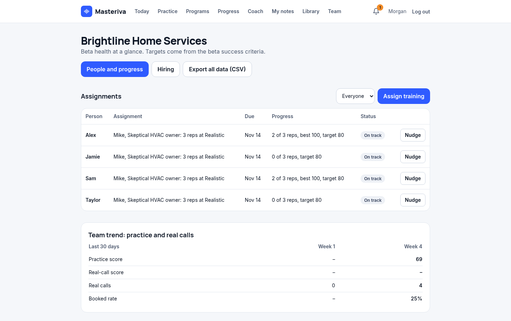 | 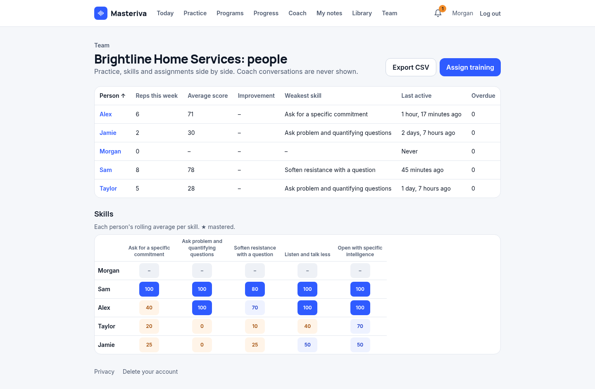 |
| **One associate** | **Candidate report** | **Public home** |
| 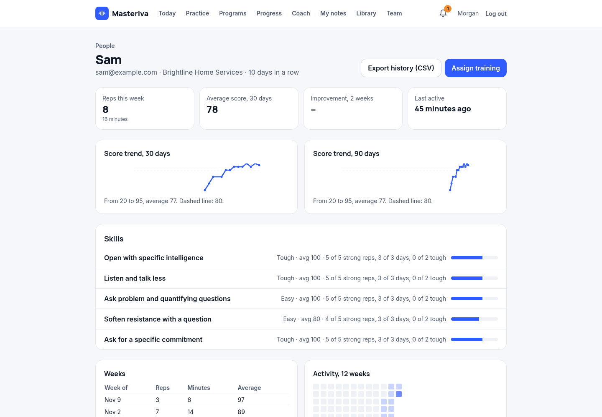 | 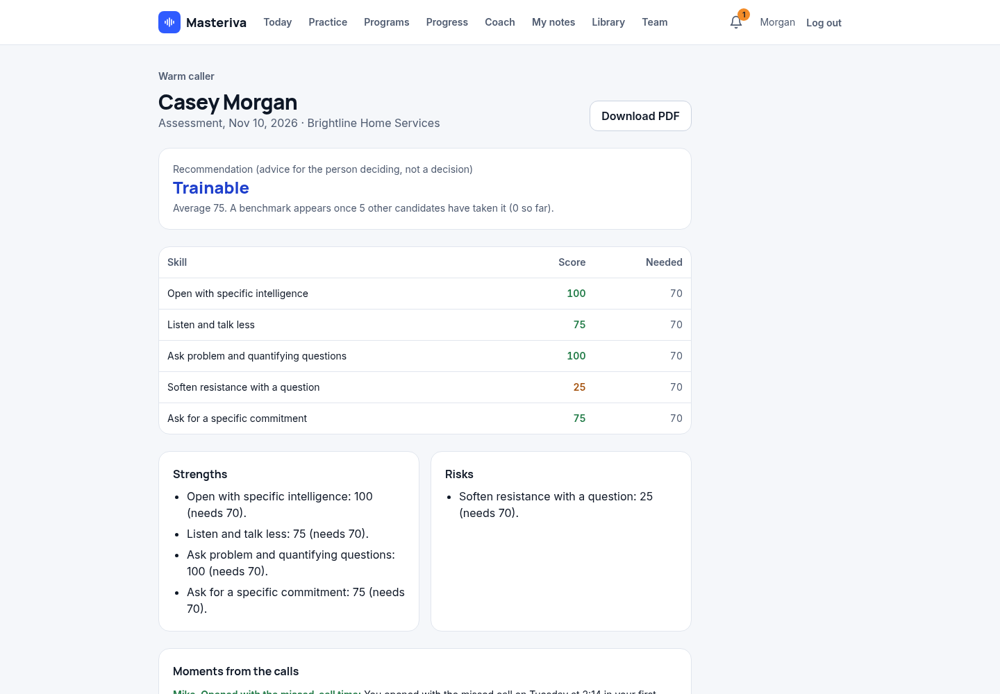 | 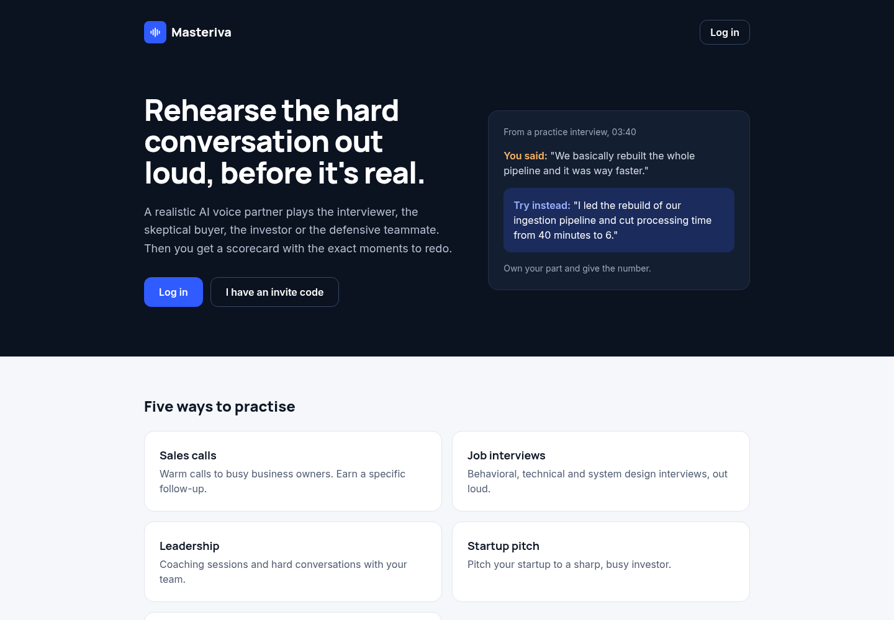 |

**On a phone** (installable as an app):

  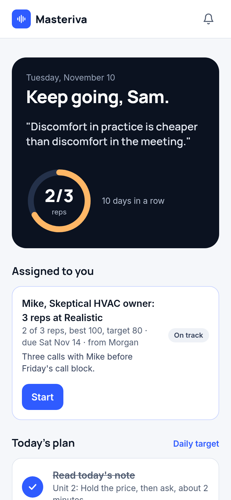
  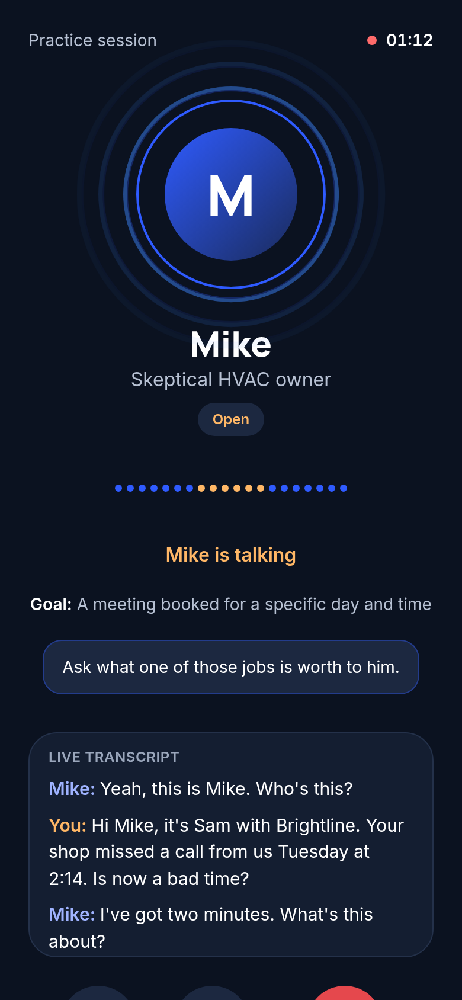
  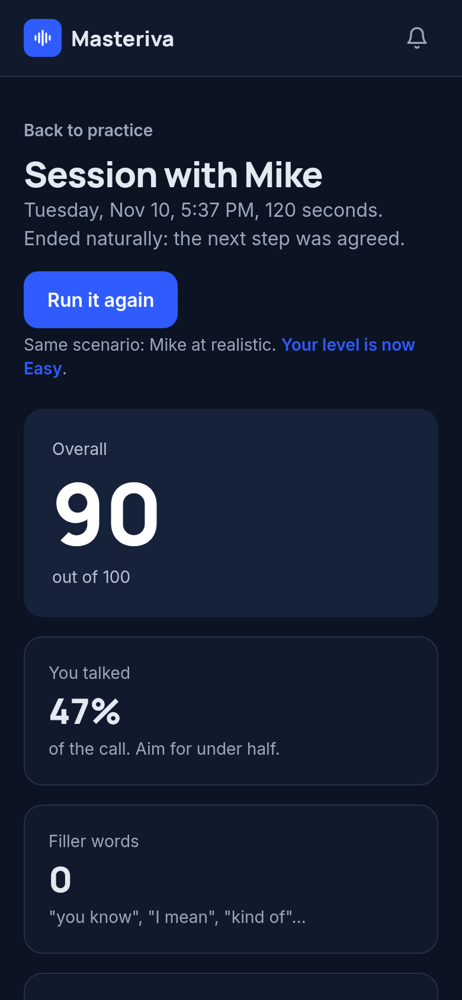
  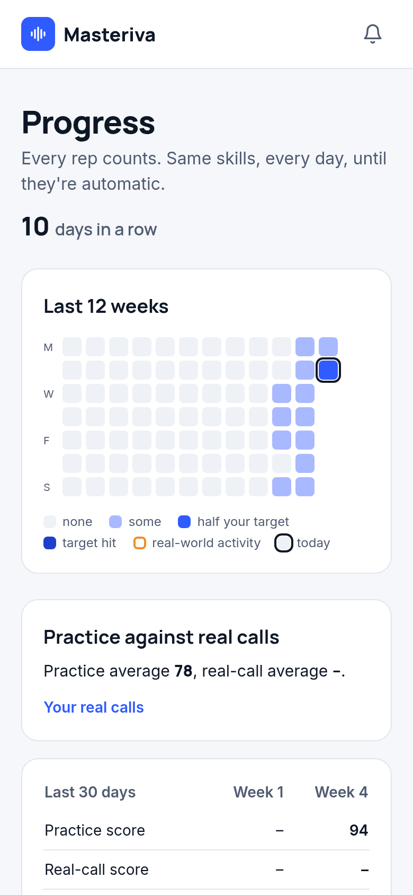
  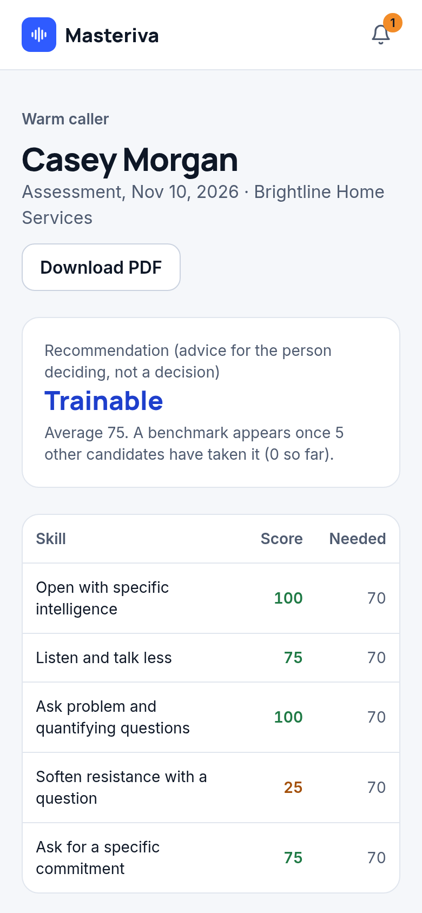

**Dark mode** follows the device setting or a per-user choice:

  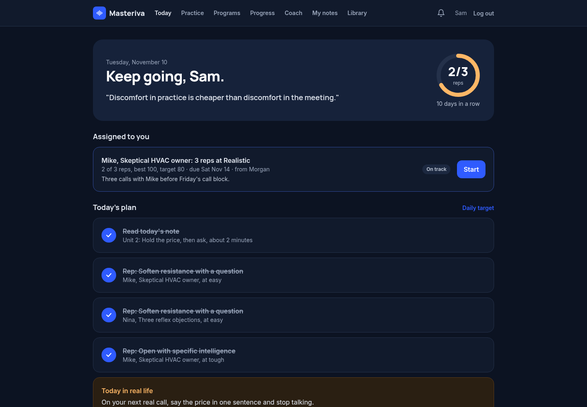
  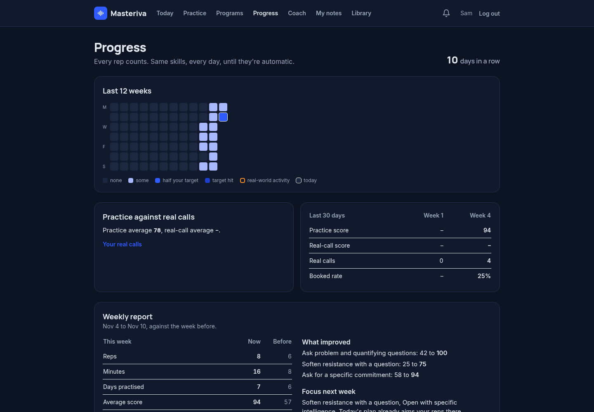
  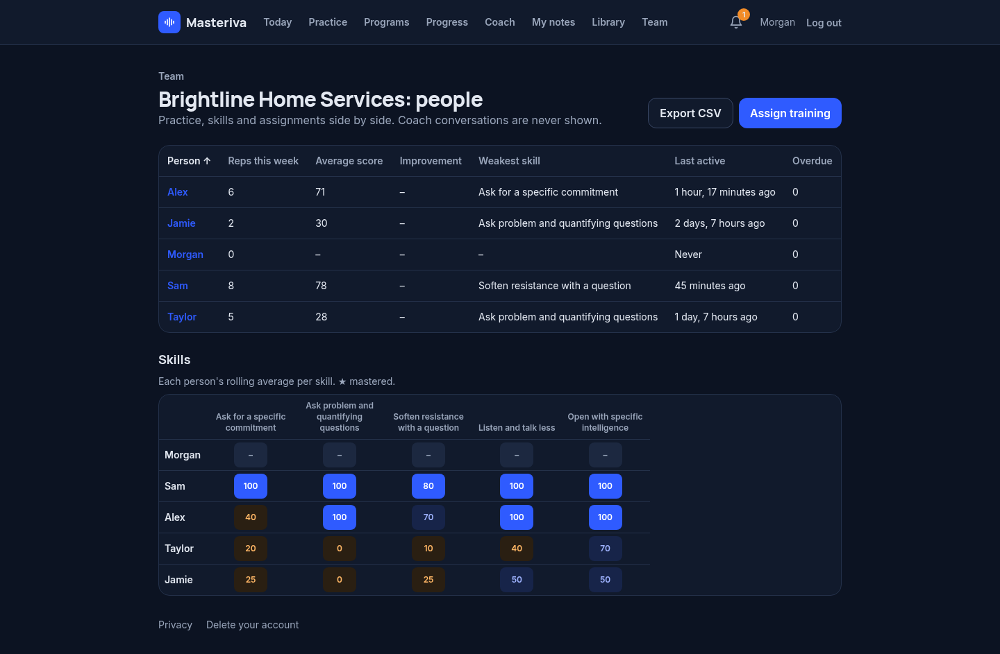

Every page in light and dark, at desktop and phone sizes, is in [`docs/screenshots`](docs/screenshots).

## Tech stack

| Layer | Technology |
| --- | --- |
| Backend | Python 3.12, Django 5.2, Django Channels 4, Daphne (ASGI) |
| Real-time | WebSockets, browser AudioWorklet (16-bit PCM), server-side relay to Deepgram Voice Agent |
| Frontend | Django templates, HTMX, Tailwind; no JavaScript build step |
| AI | Deepgram Voice Agent (speech-to-text, conversation, text-to-speech); OpenAI or Anthropic Claude for scoring, coaching and content, behind one interface |
| Data | PostgreSQL 16 in production, SQLite locally |
| Documents | pypdf (text extraction), fpdf2 (report PDFs with an embedded font) |
| Payments | Stripe, Paddle or Paystack hosted checkout |
| Infrastructure | Docker Compose on AWS, Caddy (HTTPS), cron, nightly PostgreSQL backups |
| CI | GitHub Actions: migration check and the full test suite on every push |

## Architecture overview

A single Django project served by Daphne handles both normal pages and live-call WebSockets. During a call the
browser streams microphone audio to the server, and the server relays it to the voice provider over its own
socket, so API keys and each persona's hidden instructions never reach the browser and the server keeps control of
time and cost. When the call ends, a bounded background pool scores it: measurable things are computed in code,
and the language model judges only the rubric items and writes the coaching.

Diagrams of the system and of a live call: **[docs/architecture.md](docs/architecture.md)**.

## Engineering highlights

**Real-time voice relay over WebSockets.** An AudioWorklet captures 16-bit PCM in roughly 40 ms chunks, resampling
only when the browser's rate isn't supported. A Channels consumer relays audio both ways and records every turn with
timestamps, talk time per side, reply latency and silences. The browser supports barge-in; the server owns the clock: it interrupts
monologues, nudges the persona to wrap up, hangs up after sustained silence, and ends the call when the persona signals a natural ending
through function calling. The upstream connection opens only when a call starts and closes the moment it ends,
because voice is billed by connection time.

**Cost and abuse guardrails.** Every AI request goes through a spend ledger: it reserves its worst-case cost first
and settles or fails afterwards, and rolling hourly, daily and monthly caps count running work. A live call reserves
its whole session limit up front. Retries are capped and never re-queue themselves, background work runs in a
bounded pool with deadlines, a circuit breaker pauses a provider after repeated failures, and an owner-facing kill
switch pauses all AI work; a live call notices within seconds and ends gracefully, with its transcript kept for
scoring later. One call per user, a concurrent-call cap, per-user limits, login and sign-up lockouts by email and IP,
CAPTCHA on sensitive forms and email verification before any AI use complete the picture. The operator gets a daily
report of spend by feature, errors and disk usage.

**Deterministic metrics computed in code.** Talk share, filler words, latency percentiles, silence after the ask,
voicemail length and the 100-point total are measured, not guessed. The model returns JSON validated against the
rubric, with one retry. Coaching rules are enforced in code too (second person, no "May I", next steps need a day
and a time): a line that breaks a rule goes back to the model once, then the scorecard is repaired rather than
failed. Scorecards store their rubric with labels, so old scorecards still render after a rubric changes.

**Privacy by design.** Real-call transcripts and candidate reports stay private until their owner shares them, and
sharing can be withdrawn. Coaching conversations and what the coach remembers are private to the user: never in team
pages, the admin console or the database admin. Uploaded PDFs are kept as extracted text and a summary, never as
files. User and document text enters prompts as quoted data that can't change roles or limits. Users can delete
their account, and candidates their hiring data, from the app. The service worker never caches pages or API
responses, so nothing private stays on a shared phone.

**Provider abstractions.** Voice sits behind a small `VoiceSession` interface (start, audio, send, events, end, cost),
text AI behind one interface over OpenAI and Claude with a shared ledger and retry policy, and payments behind one
interface over Stripe, Paddle and Paystack (checkout, verify, parse). Swapping or adding a provider doesn't touch the
call relay, scoring or billing logic.

**Webhook security and integrations.** Payment webhooks from Stripe, Paddle and Paystack are verified with HMAC
signatures (SHA-256 or SHA-512, depending on the provider), compared in constant time, checked for freshness where
the provider signs a timestamp, and deduplicated by event ID, so a forged or replayed event can't change a
subscription. Checkout happens on the provider's hosted page, so card details never reach Masteriva. Reminder and
progress emails carry one-click unsubscribe headers, and CAPTCHA (Cloudflare Turnstile or reCAPTCHA) guards sign-up,
password reset and repeated failed logins.

## Testing and CI

- **379 automated tests in 24 test files** across 12 Django apps, all passing in the latest full run; no API keys
  needed.
- **A simulated voice call:** a full call runs through the real WebSocket relay against a fake voice-provider socket,
  checking the transcript, timings, natural endings, silence handling and guardrails end to end.
- **A network-blocked test harness:** on a test run every provider key is blanked before settings load, and sockets
  and DNS refuse anything but local addresses. Any outbound attempt is logged and fails the whole run, even if the
  code under test catches the exception.
- **Clean-clone CI:** GitHub Actions installs from `requirements.txt` on a fresh runner, checks for missing
  migrations and runs the full suite on every push and pull request.

## Deployment

- **Docker Compose on AWS:** the web container (Daphne) and PostgreSQL 16, each with memory and CPU limits and
  health checks. The database sits on a private network only.
- **Caddy and HTTPS:** a reverse proxy with automatic certificates. The configuration is validated before every
  reload. Health and readiness endpoints feed an external uptime monitor.
- **CPU priority for voice on a shared server:** the server also runs a video-rendering app, so the web container
  gets a higher CPU share, which keeps voice latency steady while renders run.
- **Nightly backups:** compressed `pg_dump` files with two weeks of retention and a documented restore procedure.
- **Cron jobs:** reminders and follow-ups, weekly progress emails, a stale-call sweep, the daily ops report and the
  backup. Each runs under a lock and a timeout, so a slow run can't overlap the next.

## Key decisions and trade-offs

- **Web first, plus an installable app.** One codebase serves desktop and phone, installs as a PWA and gets
  microphone access over HTTPS. Native apps can come later; the service worker is in place for push notifications.
- **Scores computed in code.** Measurable numbers come from the transcript and timings, and the model judges only
  what needs judgment. Scores stay consistent between calls, explainable to users and testable.
- **Audio relayed through the server.** Direct browser-to-provider audio would save a hop, but relaying keeps keys
  and hidden persona instructions server-side and lets the server enforce time and cost limits.
- **Server-rendered UI with HTMX.** No build step and fewer moving parts, at the cost of richer client-side
  interactivity where it isn't needed.

## Roadmap

- Push notifications to the installed app (the service worker is already in place)
- Native mobile apps
- More voice providers behind the existing interface
- CRM and chat integrations, and single sign-on for larger teams

## Source code

**Source code is private; available on request for interviews.**

## Credits

The sales coaching draws on ideas from **Art Sobczak**, *Smart Calling* (Wiley, 2013), and **Brian Tracy**,
*The Psychology of Selling*, in our own words. Masteriva paraphrases these ideas only and credits them wherever
they're used. No text from either book is reproduced.
