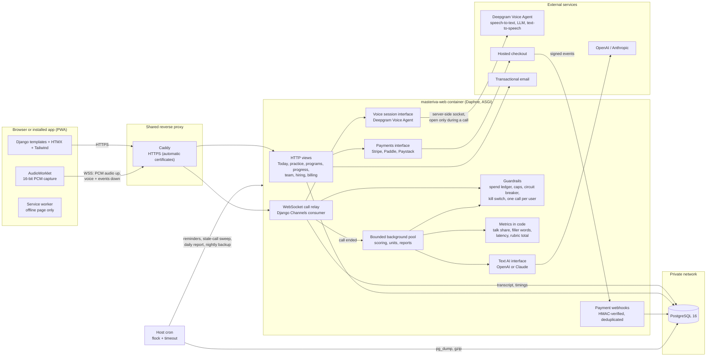
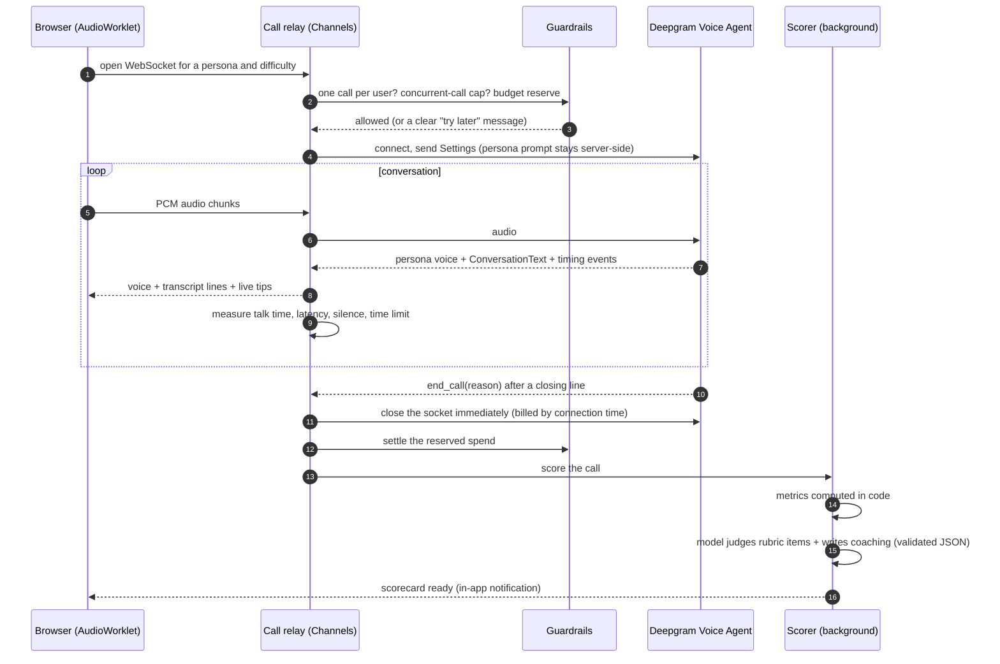

# Masteriva architecture

One Django project served by Daphne (ASGI), so normal HTTP pages and the live-call WebSockets run in the same
process. Pages are server-rendered Django templates with HTMX; there is no JavaScript build step.

## A live call, step by step

## Apps

| App | Responsibility |
| --- | --- |
| `practice` | Personas, the live-call relay, scoring, metrics, skills, difficulty, the spend ledger and guards |
| `learn` | Programs and daily units, Today, daily evaluation, next steps, real-call logging |
| `coach` | Private text and voice coaching grounded in the user's own documents |
| `notify` | In-app and browser notifications, email with one-click unsubscribe |
| `assign` | Training assignments; progress recomputed from activity only |
| `insights` | Team progress for owners, alerts, weekly team report |
| `hire` | Hiring assessments, consent, reports (web and PDF), certification and public verification |
| `billing` | Plans, hosted checkout, verified webhooks |
| `accounts`, `console` | Sign-up, verification, lockouts, CAPTCHA, the owner console |
